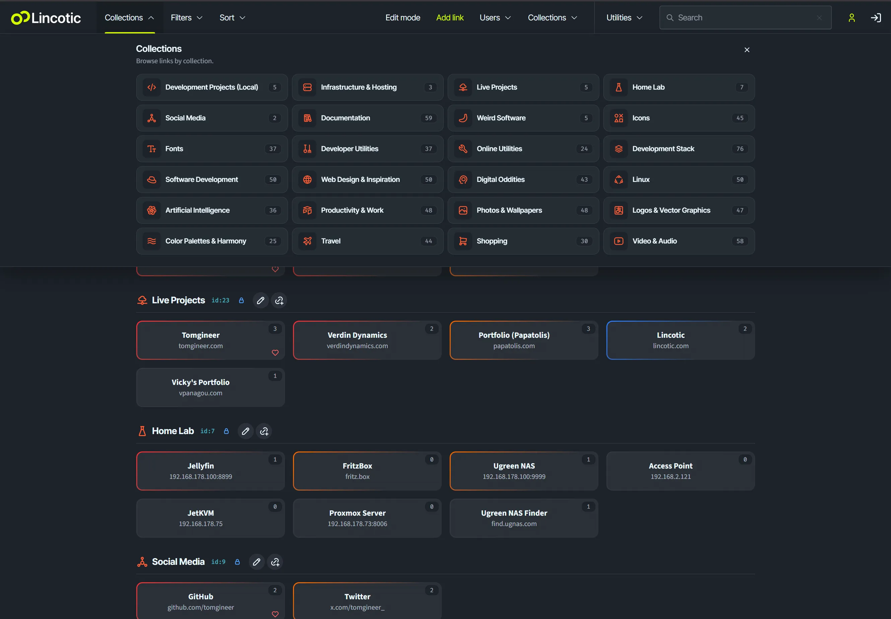
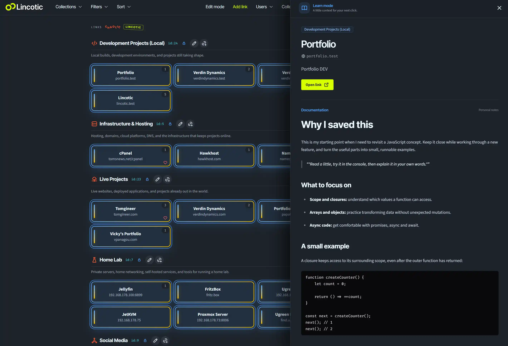

# Lincotic

### Your links, organized into personal hubs.

Lincotic is a focused, self-hosted knowledge and link platform for individuals, teams, and organizations that have outgrown browser bookmark folders and bare lists of URLs. Every user gets an independent hub for organizing, documenting, searching, sharing, and maintaining useful resources.

Save with context. Find things quickly. Share only what should be public.

## One organizational home, multiple personal hubs

Lincotic gives an organization a central home for shared resources while keeping every user's library separate.

The configured root account appears at `/` and can act as a **virtual user representing the organization itself** rather than an individual employee. Its hub becomes the company's front door to the browser-based systems, internal services, reference material, and frequently used links that employees need. Collections can organize those resources by department—such as HR, Finance, Sales, Support, Engineering, or Operations—or by workflow, location, project, or business function.

The organizational hub is backed by a normal Lincotic account, so it retains the same ownership and visibility rules as every other hub. Alongside that shared starting point, each employee can have an independent personal space at `/@username` for the resources relevant to their own role.

- The organization's configured root hub is available at `/`.
- Every active user has a public route at `/@username`.
- Search, filters, collections, link totals, and visit totals are scoped to the selected user.
- Signing in takes users directly to their own hub.
- Inactive accounts and their outbound link redirects are not publicly accessible.

The root hub is selected with `lincotic.rootUsername` in the environment configuration. Usernames contain lowercase letters and numbers so hub URLs remain simple and predictable.

## A clear permission model

Public browsing, personal ownership, and account administration are separate capabilities.

| Capability | Visitor | User | Administrator |
| --- | --- | --- | --- |
| Browse public content in active hubs | Yes | Yes | Yes |
| View hidden content in own hub | No | Yes | Yes |
| Edit links and collections in own hub | No | Yes | Yes |
| View or edit another user's hidden content | No | No | No |
| Create and manage user accounts | No | No | Yes |

Administrator access does not override library ownership. An administrator can create accounts, assign the `user` or `admin` role, update credentials, and activate or deactivate accounts, but each user's private content remains visible and editable only to its owner.

## Organize links with purpose

Build a library around the way you think and work.

- Group links into named collections with descriptions and custom SVG icons.
- Feature the collections that belong on the main dashboard.
- Reorder collections to reflect your priorities.
- Recover links without a collection through the dedicated **Unassigned** view.
- Add titles and notes that preserve why a resource matters.
- Mark individual links or complete collections as hidden.

Each link and collection belongs to one user. Ownership checks also apply to editing requests, so one account cannot load, change, move, reorder, or delete another account's content.

## Find the right link in seconds

Search works inside the current hub and matches link titles, URLs, and descriptions. Results can include links that are not assigned to a collection.

Focused controls let you narrow a hub by:

- Collection, including featured and unassigned views
- Favorite, pending review, or unflagged status
- High, medium, low, or default importance

Sort links by importance, title, date added, date updated, popularity, most recent visit, or oldest first.

## Turn bookmarks into a working dashboard

Lincotic adds useful signals to every saved destination.

- **Importance levels** separate urgent resources from everyday references.
- **Favorites** keep essential destinations easy to isolate.
- **Pending review** identifies links that need another look.
- **Visit counts** show which resources are used most often.
- **Last visited timestamps** bring recent activity into view.
- **Hidden status** keeps selected content available only to its owner.

Hub totals respect the same visibility rules as the link list, so private content does not leak through public counters.

## Learn before you open

A bookmark tells you where something is. **Learn Mode** explains what it is, why it matters, and how to use it before you leave Lincotic.

For organizations, this turns a browser-based tools hub into an onboarding and operational knowledge layer. A link can explain what a system does, who owns it, where access is requested, which prerequisites are required, how common workflows are completed, when to escalate, and even preserve reusable code or boilerplate. New employees gain context without guessing, while experienced colleagues have one place to record the details that are otherwise passed around informally.

For personal libraries, the same space answers the questions ordinary bookmarks forget: Why did I save this? What did I learn? Which part was useful? How do I use it again? Each link can hold long-form, formatted documentation—up to 16 MB of sanitized HTML, theoretically around 1.5 million words depending on language and formatting.

Enable Learn Mode from the navigation bar and select a link to read its documentation, description, collection, destination, and activity without opening the external site. Owners write and update the content through the link editor. Documentation follows the visibility of its link: notes on public links are public, while hidden content remains available only to its owner.

[Read the complete Learn Mode guide](docs/learn-mode.md).

## Edit without leaving the hub

Owners can enable edit mode and manage their library through focused, responsive dialogs.

- Create, update, and remove links and collections.
- Move links between collections.
- Add descriptions, importance, favorites, review status, and visibility settings.
- Paste or test destinations directly from the link editor.
- Reorder collections from the interface.

Standard users have full control of their own library. They do not need an administrator role to manage their content.

## Share public resources, protect private ones

Visitors can browse the visible content of any active user's hub without an account. Hidden links and links inside hidden collections are available only to the hub owner, including when someone tries to open a direct outbound redirect.

Authentication and roles are powered by [CodeIgniter Shield](https://github.com/codeigniter4/shield). Public hub pages use owner-specific cache namespaces, and edits invalidate only the affected user's cached pages. This keeps public browsing fast without mixing content between users.

Because Lincotic is self-hosted, the application, database, accounts, link data, and usage data stay on infrastructure you control.

## Useful tools in the same interface

Lincotic includes four lightweight utilities alongside the link library.

### Password Generator

Generate standard or symbol-enhanced passwords in multiple lengths. Passwords use a cryptographically secure random source, are never stored, and can be copied with one click.

### Date & Time Calculator

See local time, ISO week information, calendar progress, Unix time, period countdowns, and long-range milestones in a live dashboard.

### Hash Generator

Turn text into MD5, SHA-1, SHA-256, SHA-384, and SHA-512 digests. Whitespace handling is explicit, byte count is visible, and every result is ready to copy.

### Work Time Tracker

Track an eight-hour net workday with automatic break deductions, progress feedback, and an estimated finish time. The selected start time is kept in browser local storage.

## Designed for everyday use

Lincotic is compact, responsive, and direct. The interface adapts from wide workstations to mobile screens, keeps primary navigation within reach, and simplifies controls when space is limited. Clear visual states, semantic controls, keyboard-friendly interactions, and focused editing flows make it comfortable to use throughout the day.

It is a natural fit for:

- Personal knowledge and reference libraries
- Shared start pages with individual user spaces
- Homelabs and infrastructure dashboards
- Project, research, and client resource collections
- Teams and organizations that need shared operational knowledge with user-owned spaces

## Why self-host Lincotic?

- **Ownership:** Keep links, accounts, and activity data on systems you control.
- **Separation:** Give every user an independent library and public hub.
- **Privacy:** Keep hidden content private even from other administrators.
- **Speed:** Reach useful destinations through search, filters, and activity-based sorting.
- **Focus:** Use a dedicated link workspace without the weight of a general-purpose knowledge platform.
- **Freedom:** Inspect, adapt, and extend an MIT-licensed codebase.

## Built on a maintainable foundation

Lincotic combines [CodeIgniter 4](https://codeigniter.com/) and CodeIgniter Shield on the backend with [Tailwind CSS](https://tailwindcss.com/), [daisyUI](https://daisyui.com/), and [esbuild](https://esbuild.github.io/) on the frontend. MySQL or MariaDB provides persistent storage.

The application uses server-rendered pages, focused JavaScript enhancements, explicit validation, user-scoped data access, visibility-aware redirects, isolated public caches, and automated tests around core behavior.

## Installation

The [complete installation guide](docs/installation.md) covers requirements, database creation, environment configuration, the first administrator account, local development, Apache and Nginx deployment, permissions, verification, updates, and troubleshooting.

Lincotic uses MySQL or MariaDB. A fresh installation imports [`database/schema.sql`](database/schema.sql), configures a private `.env` file, and serves the application through the `public/` directory.

## Open source

Lincotic is released under the [MIT License](LICENSE). Explore the source, adapt it to your workflow, and help make link management more intentional.

[View the repository](https://github.com/tomgineer/lincotic) | [Report an issue](https://github.com/tomgineer/lincotic/issues)
